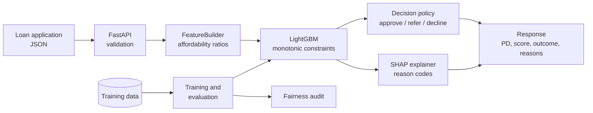
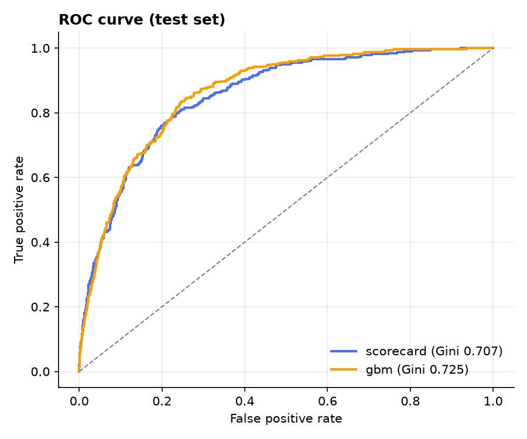
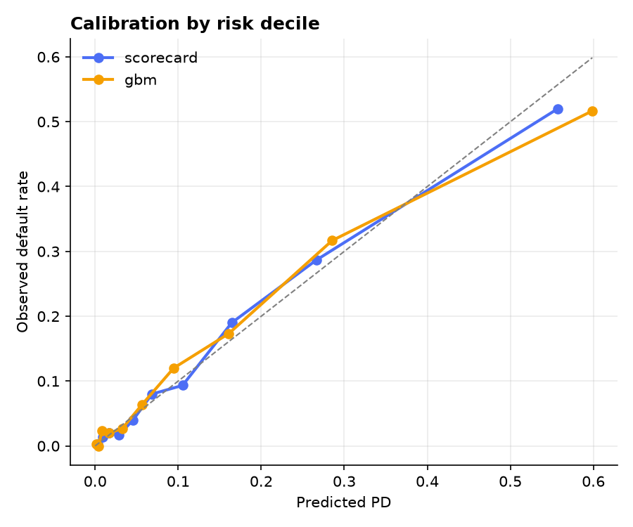
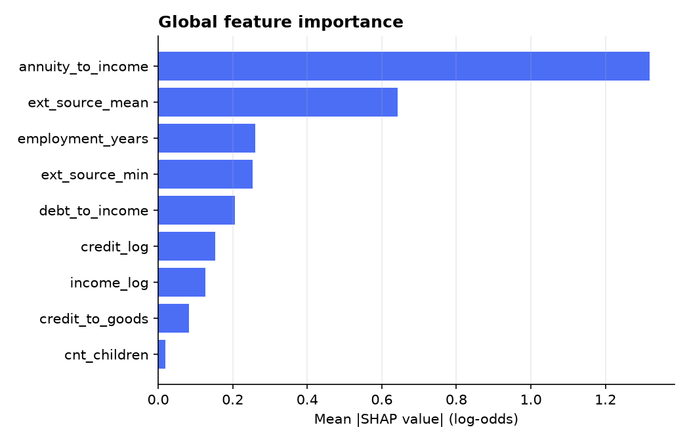
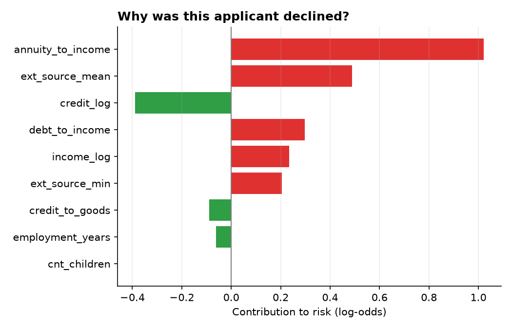
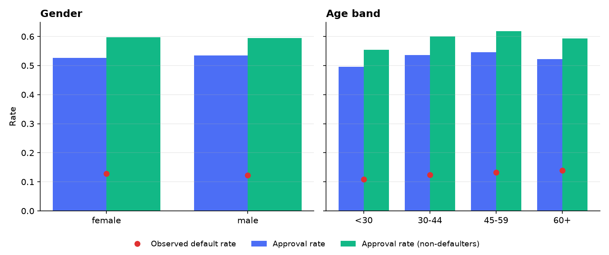

# Klarlend

[](https://github.com/shamvilrzaa/explainable-credit-underwriting/actions/workflows/ci.yml)


> Explainable credit underwriting built for the EU AI Act. Every decision comes with a probability of default, a score and the reasons behind it; uncertain cases go to a human underwriter, and every override is logged.

Klarlend consists of a probability-of-default model with monotonic constraints, SHAP-based reason codes, a fairness audit, a REST API for loan origination systems and a review console for underwriters and risk managers.

**Status:** work in progress. See the roadmap below.

## Run it

```bash
make up
```

Starts the API on http://localhost:8000 and the console on http://localhost:8501 with Docker Compose. Without Docker, use `make serve` and `make dashboard`.

## Why this project

Under the EU AI Act, AI systems used to assess creditworthiness are classified as **high-risk** (Annex III). Lenders must be able to explain decisions, monitor for bias and document their models. This project builds a credit model the way a regulated lender would have to, not just the way a Kaggle leaderboard rewards.

## Architecture



## Data

| Mode | When | Use |
|---|---|---|
| **Real** | `data/raw/application_train.csv` exists | Training and reported metrics |
| **Synthetic** | No file present | Tests, CI, demos. Same schema, no personal data |

To use the real data, download `application_train.csv` from the [Home Credit Default Risk](https://www.kaggle.com/c/home-credit-default-risk/data) competition and put it in `data/raw/`. Raw data is git-ignored and never committed.

Protected attributes (gender, age) are **excluded from the model features** and used only for the fairness audit.

## Features

| Feature | Definition | Expected effect on risk |
|---|---|---|
| `debt_to_income` | Credit amount / annual income | ↑ |
| `annuity_to_income` | Loan annuity / annual income | ↑ |
| `credit_to_goods` | Credit amount / price of financed goods | ↑ |
| `employment_years` | Years in current employment (capped at 45) | ↓ |
| `ext_source_mean`, `ext_source_min` | Mean / minimum of external bureau scores | ↓ |
| `income_log`, `credit_log` | Log of income and credit amount | – |
| `cnt_children` | Number of children | – |

The expected directions are enforced as monotonic constraints in the gradient boosting model, so the model cannot learn counter-intuitive relationships such as "more debt lowers risk".

## Quickstart

```bash
python -m venv .venv && source .venv/bin/activate
make install
make test
make train
```

| Command | Output |
|---|---|
| `make train` | Fits the scorecard and writes model, metrics, calibration table and coefficients to `artifacts/` |
| `make report` | Trains all models, compares them, explains test-set decisions and writes the charts in `docs/images/` |

## Models

| Model | Description |
|---|---|
| Scorecard | Logistic regression on standardised features, median imputation with missing-value indicators |
| Gradient boosting | LightGBM with monotonic constraints on every feature with a known risk direction |

Monotonic constraints guarantee that, all else equal, a higher repayment burden or a weaker bureau score never lowers the predicted risk. Without them, correlated features can produce counter-intuitive effects that are hard to defend to a regulator or a rejected applicant. The constraints are verified in `tests/test_gbm.py`.

## Results

Results below are on synthetic data and will be replaced with Home Credit results.

| model | Gini | AUC | KS | Brier |
|---|---|---|---|---|
| Scorecard | 0.707 | 0.853 | 0.564 | 0.085 |
| LightGBM (monotonic) | 0.725 | 0.862 | 0.589 | 0.085 |

<p float="left">
  
  
</p>

## Decisions and reason codes

Each application gets a probability of default, a points score and one of three outcomes:

| Outcome | Rule (default policy) |
|---|---|
| Approve | PD below 5% |
| Refer to an underwriter | PD between 5% and 15% |
| Decline | PD above 15% |

Every referred or declined application comes with up to four reasons, derived from SHAP values of the gradient boosting model. Only features with a defined risk direction can become a reason, so each reason is a clear, actionable statement rather than "income level".

```json
{
  "applicant_id": 113604,
  "probability_of_default": 0.1904,
  "score": 529,
  "outcome": "decline",
  "reasons": [
    {"feature": "annuity_to_income", "label": "Loan repayments are high relative to income", "value": 0.3254, "contribution": 1.0211},
    {"feature": "ext_source_mean", "label": "Weak external credit bureau scores", "value": 0.3397, "contribution": 0.4897},
    {"feature": "debt_to_income", "label": "Requested credit is high relative to income", "value": 7.3017, "contribution": 0.2966}
  ]
}
```

<p float="left">
  
  
</p>

SHAP contributions are additive in log-odds: base value plus contributions equals the model output exactly, which is checked in `tests/test_explain.py`.

## Fairness audit

Gender and age are never model inputs, but other features can act as proxies (employment length correlates with age, for example). The audit therefore checks outcomes per group on the test set:

| Check | Threshold |
|---|---|
| Approval ratio vs. best-treated group (four-fifths rule) | ≥ 0.80 |
| Approval-rate gap among applicants who did not default (equal opportunity) | ≤ 10 pp |
| Calibration gap: mean predicted PD minus observed default rate | ≤ 2 pp |



On synthetic data, approval ratios stay above 0.9 for every group, but the model overestimates risk for applicants under 30 by about 3 percentage points: their short employment history is penalised more than their actual default rate justifies. In production this would trigger a review of the employment feature or a group-level recalibration. Full tables are written to `artifacts/fairness.md`.

## Review console

```bash
make dashboard
```

| Page | Purpose |
|---|---|
| Queue | Applications in the referral band, highest risk first, with the main risk factor and override statistics |
| Review | Decision, PD, score, reasons, the largest loan that would be approved, and a form to record the underwriter's final decision |
| Batch scoring | Upload a CSV of applications and download decisions with reasons; invalid rows are reported per field |
| Policy | Simulate approval and decline thresholds, see the effect on approvals and losses, and apply a new live policy with approver and reason |
| Monitoring | Gini, KS, calibration, monotonic constraints and the fairness audit |
| Settings | Live policy and change history, model details |

The console supports light and dark mode and follows the system setting by default.

**Audit trail.** Every underwriter decision is written to the review log with the model version, the model's recommendation, the final decision, the reviewer and the rationale. Every policy change is stored with the approver, the reason and a timestamp. The API and the console read the same live policy.

## Scoring API

```bash
make serve
```

Interactive documentation is available at http://localhost:8000/docs.

| Endpoint | Description |
|---|---|
| `GET /health` | Liveness check |
| `GET /v1/model` | Model version (hash of the model file), policy thresholds and features |
| `POST /v1/decisions` | Decision for one application |
| `POST /v1/decisions/batch` | Decisions for up to 1,000 applications |

```bash
curl -X POST localhost:8000/v1/decisions -H "Content-Type: application/json" -d '{
  "applicant_id": 1001, "income_total": 54000, "credit_amount": 270000,
  "annuity": 18500, "goods_price": 250000, "employment_years": 3.5,
  "children": 1, "ext_source_2": 0.42, "ext_source_3": 0.35
}'
```

The API does not accept gender or age: unknown fields are rejected, so protected attributes cannot reach the model by accident. Every response carries the model version, which makes each decision traceable to the exact model that produced it.

### Docker

```bash
make up      # API and console with a shared data volume
make down
```

One multi-stage image serves both the API and the console. It runs as a non-root user, has health checks, and keeps the model in the image and mutable data (policy, review log) in a volume. CI builds the image on every push and sends a test request to the running container.

## Evaluation

| Metric | Meaning |
|---|---|
| Gini | `2 × AUC − 1`, the standard ranking measure in retail credit |
| KS | Maximum separation between the cumulative distributions of good and bad applicants |
| Brier score | Mean squared error of the predicted default probability |
| Calibration | Predicted vs. observed default rate per risk decile |

Probabilities of default are mapped to a points score (600 points at 50:1 good:bad odds, 20 points to double the odds), the format credit decisions are usually communicated in.

## Roadmap

- [x] Data layer: real/synthetic loader, single schema, tests, CI
- [x] Feature engineering (affordability ratios, bureau scores)
- [x] Baseline logistic scorecard with points scaling and evaluation (Gini, KS, Brier, calibration)
- [x] Monotonic LightGBM and model comparison
- [x] SHAP-based adverse-action reason codes and decision policy
- [x] Fairness audit across gender and age bands
- [x] FastAPI scoring service, Docker image and container smoke test in CI
- [x] Review console (Streamlit): referral queue, application review, batch scoring, policy management, monitoring, light and dark mode
- [x] Docker Compose setup for API and console
- [ ] Model card and AI Act technical documentation

## Kurzfassung (Deutsch)

Klarlend ist ein erklärbares Kreditscoring-System nach den Anforderungen des EU AI Act: Ausfallwahrscheinlichkeit, nachvollziehbare Ablehnungsgründe, Fairness-Prüfung, eine Scoring-API und eine Prüfoberfläche für Kreditsachbearbeiter mit lückenlosem Audit-Trail. Sensible Merkmale (Geschlecht, Alter) fließen nicht ins Modell ein und dienen nur der Fairness-Analyse.
